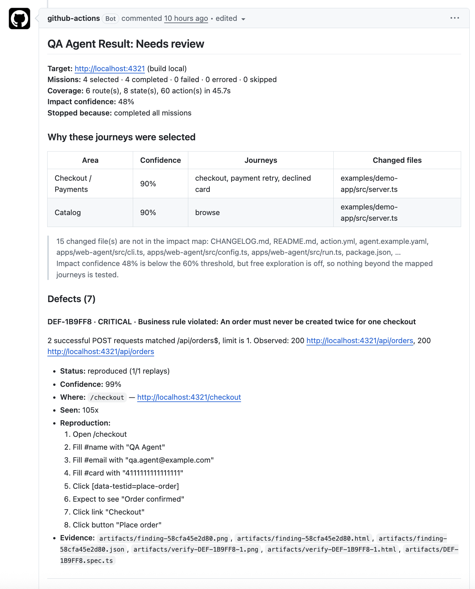

# Autonomous Test Agent

**An automated exploratory QA tester for your web app.** When your test
environment is up, the agent opens the real application in a browser, explores
it, and collects evidence of anything that looks broken.

> For each pull request, it explores the workflows the change affects and gives
> reviewers bug evidence they can reproduce.

- **Tests what changed.** It reads the PR diff and runs the journeys that diff touches.
- **Explores on its own.** It doesn't only replay a script; it picks its own clicks, inputs and links.
- **Checks before it reports.** Every finding is replayed from a clean start first.
- **Comes with evidence.** Each defect has steps, screenshots, logs, a Playwright trace and a runnable repro script ([see an example report](#what-the-pr-report-looks-like)).
- **Safe by default.** It is advisory only, blocks destructive actions and stays on the hosts you allow.

**Contents:** [How it works](#how-it-works) ·
[Quick start](#quick-start) ·
[Set up your app](#set-it-up-for-your-app) ·
[Authentication](#authentication) ·
[Pull requests](#testing-a-pull-request) ·
[GitHub Actions](#run-it-in-github-actions) ·
[Reference](#reference) ·
[Good to know](#good-to-know)

---

## How it works

Your CI starts the application and its database. The agent takes over from there.

Say someone opens a PR that changes checkout:

1. **Read the changes.** It maps the changed files to the checkout and payment
   journeys, using the `impactMap` in your config.
2. **Pick what to test.** It runs the affected journeys. You can also have it
   run every critical journey on every PR.
3. **Explore the app.** It inspects each page, picks actions, fills fields,
   clicks controls and follows links.
4. **Spot problems.** It looks for crashes, failed API calls, broken links,
   buttons that do nothing, and breaks in your business rules.
5. **Replay and report.** It tries to reproduce each finding, then reports it
   with steps, screenshots, logs, a trace and a repro script.

### How is this different from my Playwright tests?

| Scripted Playwright tests | This agent |
| --- | --- |
| Follow the workflows you write | Also chooses its own actions while exploring |
| Check the assertions you define | Also watches for general signs of failure |
| Run whatever scope your suite config sets | Uses the PR's changes to pick relevant journeys |

It works alongside your test suite. It doesn't replace it.

### What you still provide

The agent doesn't know your product. It can't tell that a discount should be
15%, or that a viewer must never see a Delete button. You write those
expectations down as [rules](#5-add-your-business-rules) or scripted
journeys in the config.

> **About AI:** Claude helped write this code, but no AI model runs inside the
> agent. Exploration uses Playwright and a deterministic heuristic planner, so
> you need no API keys or model calls. An AI planner is a planned extension.

### What it catches

Built in, with no setup:

- Page crashes and unhandled JavaScript exceptions
- Failed HTTP requests (all 5xx, and 4xx unless you mark them as expected)
- Broken links
- Buttons and controls that do nothing when clicked
- Form submits with no visible outcome
- Blank screens, endless spinners and error pages
- Accessibility violations through axe-core, serious and critical only (turn on with `oracles.accessibility: true`)

It also checks any business rules you configure.

---

## Quick start

Try it on the bundled demo shop, which has six bugs planted in it.

**You need:** Node.js 20 or later, and git.

```bash
npm install
npm run build
npx playwright install chromium

# Terminal 1: start the buggy demo shop on http://localhost:4321
npm run demo:serve

# Terminal 2: let the agent explore it (add --headed to watch the browser)
npm run explore -- --config agent.example.yaml --max-steps 60
```

The agent should find and reproduce all six bugs:

- an order created twice
- an order booked on a declined card
- an HTTP 500
- an unhandled exception
- a dead "Apply coupon" button
- a broken Help link

### Where the results go

Each run writes a folder, `runs/<run-id>/`:

| File | What it's for |
| --- | --- |
| `report.html` | Self-contained report. Open this first |
| `report.md` | The same report, formatted for a PR comment |
| `run.json` | Machine-readable result |
| `artifacts/` | Screenshots, DOM snapshots, console log, `trace.zip`, and a `DEF-*.spec.ts` repro for each defect |

---

## Set it up for your app

Copy [agent.example.yaml](agent.example.yaml) into your app's repository (for
example as `qa/agent.yaml`) and work through its sections in this order.

### 1. Point it at your test environment

```yaml
target:
  baseUrl: https://staging.example.com
safety:
  allowedHosts: [staging.example.com]
```

`allowedHosts` keeps the agent on your app (subdomains included). **Never point
it at production.**

### 2. Log in, if your app needs it

See [Authentication](#authentication).

### 3. Describe your critical journeys

Critical journeys are the flows that must always work. Script one fully, or
give it a starting page and let the agent explore from there:

```yaml
criticalJourneys:
  - id: checkout
    name: Checkout
    goal: A customer can place an order and see a confirmation
    startUrl: /checkout
    script:
      - { kind: goto, value: /checkout }
      - { kind: fill, selector: '#email', value: qa@example.com }
      - { kind: click, selector: '[data-testid=place-order]' }
      - { kind: expectText, value: 'Order confirmed' }

  - id: browse
    name: Browse products
    goal: A customer can browse products and reach the cart
    startUrl: /products
    hints: [product, cart, add]   # words that steer exploration
```

### 4. Map your code to journeys

`impactMap` tells the agent which journeys a code change puts at risk:

```yaml
impactMap:
  - paths: ['src/checkout/**', 'src/components/Payment*']
    area: Checkout / Payments
    journeys: [checkout, payment retry, declined card]
    confidence: 0.9
```

If a journey name matches a critical journey's `id` or `name`, that journey runs
with its script. Any other name, such as `payment retry`, becomes a focused
exploration of that area.

### 5. Add your business rules

Rules state what the agent can't work out for itself:

```yaml
rules:
  - id: single-order-per-checkout
    description: An order must never be created twice for one checkout
    maxRequests: { method: POST, urlPattern: '/api/orders$', max: 1 }
    severity: critical

  - id: no-delete-for-viewers
    description: A viewer must not see the delete button
    route: /profile
    forbidElement: { role: button, name: delete }
    severity: high
```

A rule can limit how many times a request happens (`maxRequests`), forbid
some text (`forbidText`), or forbid an element (`forbidElement`) on a given
`route`.

### 6. Run it

```bash
npm run explore -- --config path/to/agent.yaml --headed
```

Then tune the run. `limits` sets the step and time budgets, `oracles.ignorePatterns`
quiets known noise, and `knownFalsePositives` holds findings you've already
dismissed.

---

## Authentication

The agent can test pages behind a login. There are two ways to set it up.

### Option 1: Log in with scripted steps

Add your login steps, using your app's selectors:

```yaml
auth:
  steps:
    - { kind: goto, value: /login }
    - { kind: fill, selector: '#email', value: qa@example.com }
    - { kind: fill, selector: '#password', value: '<test-password>' }
    - { kind: click, selector: 'button[type="submit"]' }
  verifyText: Dashboard
```

- The steps run **once**, before any testing starts.
- Afterwards the agent checks that `verifyText` ("Dashboard") is visible.
- If a step fails or the text is missing, the agent records an authentication
  failure, saves a screenshot of where it got stuck, and skips testing. The run
  ends with an `error` result, never a pass.

**Keep the password out of git.** The config loader doesn't expand environment
variables, so a literal `${QA_PASSWORD}` would be typed into the field as-is.
Generate the config from your CI secrets at runtime instead:

```yaml
# qa/agent.template.yaml contains:  value: '${QA_PASSWORD}'
- name: Write agent config
  run: envsubst '$QA_PASSWORD' < qa/agent.template.yaml > qa/agent.yaml
  env:
    QA_PASSWORD: ${{ secrets.QA_PASSWORD }}
```

Use a dedicated test account. The agent clicks around freely once it's logged in.

### Option 2: Reuse a saved browser session

```yaml
auth:
  storageStatePath: playwright/.auth/user.json
```

- A separate Playwright setup script logs in and saves the browser state (see
  [Playwright authentication](https://playwright.dev/docs/auth)).
- The agent loads that file when it opens the browser.
- The session must be valid for the environment you're testing. Regenerate it
  before each run, or at least whenever it expires.
- **Keep the file out of git** (add `playwright/.auth/` to `.gitignore`). It
  contains live session cookies.

### Which one should I use?

| Your login | Use |
| --- | --- |
| Plain email and password | Option 1 (scripted steps) |
| SSO, MFA, OTP or CAPTCHA | Option 2, with a session prepared beforehand (for example through a test-only bypass) |

### Current limitations

- **OTP, MFA, SSO and CAPTCHA** need app-specific setup or a session prepared in advance.
- **No automatic re-login.** If the agent logs itself out or the session
  expires during exploration, it doesn't sign back in. To stop it clicking
  logout, add `logout`, `log out` and `sign out` to `safety.destructiveKeywords`.
- **Saved sessions aren't verified.** `verifyText` only runs with login `steps`.
  If a saved session has expired, the agent may test your logged-out pages
  without any warning.

---

## Testing a pull request

```bash
npm run pr -- \
  --config agent.example.yaml \
  --base origin/main --head HEAD \
  --url https://preview-123.example.com
```

**What runs:**

- **By default:** only the journeys the diff maps to through `impactMap`, each
  within its own budget. Areas the change didn't touch aren't tested.
- **`alwaysRunCriticalJourneys: true`** (or `--always-run-critical-journeys`)
  also runs every critical journey on every PR.
- **`freeExploration: true`** (or `--free-exploration`) spends the leftover
  budget exploring the rest of the app. It's also the only way a low-confidence
  impact match widens the scope.

`explore` mode always runs every critical journey and explores freely.

### What the PR report looks like

This is a real report the agent posted on a pull request in this repository:

<p align="center">
  
</p>

How to read it, from top to bottom:

1. **Result and summary.** The heading gives the result. Below it are the
   target, how many missions ran, completed, failed, errored or were skipped,
   the coverage (routes, states and actions in how long), the impact
   confidence, and why the run stopped.
2. **Why these journeys were selected.** For each area, the table shows the
   changed files that matched it and the journeys that ran because of them.
   Below the table, the report lists changed files that aren't in your
   `impactMap`. It also says whether the scope widened. Here, confidence was
   48%, below the 60% threshold, but free exploration was off, so only the
   mapped journeys ran.
3. **Defects.** Each defect shows its ID, severity and what went wrong. Below
   that are:
   - whether it was **reproduced** on replay (1/1 here) and how confident the
     agent is
   - where it happened and how often it was seen
   - step-by-step reproduction
   - evidence files: screenshots, DOM snapshots, and a runnable `DEF-*.spec.ts`
4. **Further down** (not in the screenshot), a **Scope tested** table lists
   each flow, its result, its steps and the routes it reached. A **Not tested**
   table lists anything the budget didn't reach, followed by the final
   **Recommendation**.

The evidence files are in the workflow artifact, or under `runs/<run-id>/`
when you run the agent locally.

### Results

| Result | PR comment says | Exit code | Meaning |
| --- | --- | --- | --- |
| `pass` | Passed | `0` | It tested the selected scope and found nothing |
| `review` | Needs review | `1` | It found something worth a look (advisory) |
| `block` | Failed | `2` | It reproduced a high-severity defect. This fails CI only in blocking mode |
| `error` | Could not test | `3` | It couldn't test, for example because login failed or every mission broke |

A few details:

- **Nothing to test.** A diff that maps to no journey exits `0`, but the report
  says **Nothing to test** rather than "passed".
- **A broken journey isn't an agent error.** When a journey runs and your app
  breaks, that's a test result, and its defect decides the outcome. Exit code
  `3` is only for when the agent itself couldn't run.

---

## Run it in GitHub Actions

This repository is also a GitHub Action, so other repositories can use it
without copying any code:

```yaml
name: QA Agent
on: pull_request

permissions:
  contents: read
  pull-requests: write

jobs:
  explore:
    runs-on: ubuntu-latest
    timeout-minutes: 20
    steps:
      - uses: actions/checkout@v4
        with:
          fetch-depth: 0 # needed to compare both sides of the diff

      # ...start your preview environment here...

      - uses: prashanth-sams/autonomous-test-agent@v1
        with:
          url: ${{ vars.PREVIEW_URL }}
          config: qa/agent.yaml
          comment: 'true'
```

Points to note:

- **You provide a running environment.** The action builds the agent and
  installs Chromium itself, but it doesn't start your app or seed its data.
- **`fetch-depth: 0` is required in `pr` mode.** Without it the agent can't
  read the diff, so nothing runs unless one of the wider scopes is turned on.
- **`comment: 'true'` posts the report on the PR.** Each run posts the new
  report at the bottom of the PR and deletes the old one. It needs
  `pull-requests: write` and is skipped for PRs from forks.
- **The job rarely fails.** It fails only if the agent can't run, or if you set
  `blocking: 'true'` and it reproduces a blocking defect. The report always goes
  to the job summary, and the evidence is uploaded as an artifact.

For a working example, see [.github/workflows/qa-agent.yml](.github/workflows/qa-agent.yml).
It runs this action against the demo app on every PR in this repository.

<details>
<summary><strong>All inputs</strong></summary>

| Input | Default | Purpose |
| --- | --- | --- |
| `url` | *required* | Base URL of a test or preview environment (never production) |
| `mode` | `pr` | `pr` for impact-driven testing, `explore` for a free exploratory run |
| `config` | — | Agent config path, relative to your repository root |
| `base` / `head` | `origin/<base_ref>` / `github.sha` | Refs compared in `pr` mode |
| `changed-files` | — | Comma-separated paths to use instead of running `git diff` |
| `always-run-critical-journeys` | `false` | `pr` mode: run every critical journey, not only the ones the diff maps to. `false` defers to the config |
| `free-exploration` | `false` | `pr` mode: explore the whole app with the leftover budget. `false` defers to the config |
| `max-steps` | — | Override the step budget from the config |
| `output-dir` | `qa-agent-runs` | Where reports and evidence are written |
| `blocking` | `false` | Let a reproduced blocking defect fail the job |
| `comment` | `false` | Post the report as a PR comment, replacing the previous one |
| `upload-artifact` | `true` | Upload the run folder as a workflow artifact |

</details>

<details>
<summary><strong>All outputs</strong></summary>

| Output | Description |
| --- | --- |
| `result` | `pass`, `review`, `block` or `error` |
| `exit-code` | `0` pass, `1` review, `2` block, `3` agent error |
| `run-id` | ID of the completed run |
| `run-dir` | Absolute path to the run folder |
| `report-markdown` / `report-html` / `run-json` | Absolute path to each report |

</details>

---

## How you can trust the findings

- **Every finding is replayed from a clean state** before it's reported. Only
  reproduced, high-severity defects can recommend blocking a merge.
- **A broken critical journey is re-run from its script**, so it's checked again
  exactly as you configured it.
- **Replays start with a fresh request log**, so a rule like "at most one order"
  can't trigger again just because the first attempt already counted.
- **Duplicates are merged.** Findings you've dismissed can be suppressed with
  `knownFalsePositives`.
- **The report is honest about scope.** It says which journeys it picked and
  why, what it tested, and what it didn't test.

## Safety

- **Advisory by default.** It can't block a merge unless you opt in (`mode:
  blocking` in the config, `--blocking` on the CLI, or `blocking: 'true'` in the
  Action).
- **Destructive actions are blocked.** Anything matching `destructiveKeywords`
  (delete, deactivate, wipe, purge…) or `prohibitedActions` is skipped, and the
  report lists what was skipped.
- **It stays on your hosts.** Navigation outside `allowedHosts` is blocked.
- **Secrets are masked.** Values for keys in `redactKeys` are hidden in evidence
  and reports.
- **Use test environments, test accounts and test data.** Never production.

---

## Reference

### Configuration

The annotated example is [agent.example.yaml](agent.example.yaml).

| Section | Purpose |
| --- | --- |
| `target` | Base URL and build identifier |
| `auth` | Login steps or a saved session (see [Authentication](#authentication)) |
| `criticalJourneys` | Flows that must always work, optionally scripted. A PR runs one when the diff maps to it; `explore` runs them all |
| `alwaysRunCriticalJourneys` | Default `false`. When `true`, every PR runs every critical journey |
| `impactMap` | Maps changed paths to an area, its journeys, and a confidence score |
| `freeExploration` | Default `false`. When `true`, PR runs explore the rest of the app with leftover budget |
| `rules` | Business rules the agent can't work out for itself |
| `limits` | Step, time and defect budgets, plus how many times to retry verification |
| `safety` | Allowed hosts, prohibited and destructive actions, and keys to redact |
| `oracles` | Which checks run, and what noise to ignore |
| `knownFalsePositives` | Findings people dismissed in earlier runs |
| `browser` | `chromium`, `firefox` or `webkit`, headless or not, and viewport |
| `reporting` | Output folder, trace, video and HAR capture |
| `mode` | `advisory` (default) or `blocking` |

### CLI

Run with `npm run explore --` / `npm run pr --`, or call
`node apps/web-agent/dist/cli.js` directly.

```
qa-web-agent explore [--url <baseUrl>] [--config agent.yaml] [options]
qa-web-agent pr      --base <ref> --head <ref> [--config agent.yaml] [options]

--max-steps <n>        Override the step budget
--headed               Show the browser window
--browser <name>       chromium | firefox | webkit
--out <dir>            Output directory (default: runs)
--blocking             Allow the agent to recommend blocking a merge
--changed-files <a,b>  Use these files instead of running git diff
--free-exploration     pr: explore the whole app with the leftover budget
--always-run-critical-journeys
                       pr: run every critical journey, impacted or not
--json                 Print the run summary as JSON
```

---

## Good to know

- **Web only for now.** It drives Chromium, Firefox or WebKit through Playwright.
- **It doesn't set up your environment.** Your CI (or you) must start the app,
  database and test data first.
- **It only knows your product through your config.** The more journeys, hints
  and rules you give it, the more useful its findings are.
- **No AI model inside yet.** The planner is a deterministic heuristic.

### Not built yet

Mobile and desktop testing, a GitHub App (the workflow uses the Actions token),
an AI planner, run history across executions, and visual regression testing.

## Development

```bash
npm test
```

The unit tests cover impact analysis, defect deduplication and confidence, the
merge recommendation, the safety policy, risk scoring, the oracles, verification
of broken critical journeys, and the tested-scope report.
